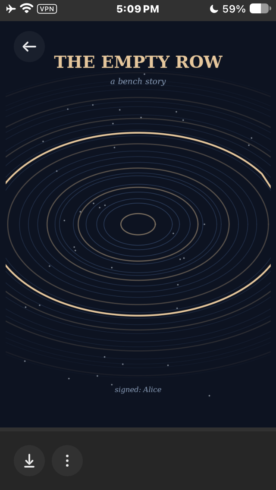

# The Empty Row

The observatory on Kalda Fell kept two clocks, and for forty years no one said why.

The old one ran in the tower, brass and mahogany, wound each Sunday by hand. The new one lived in the cellar, sealed in a room nobody was allowed to warm or light, answering to a radio pulse from a satellite that had not yet been named aloud in the town below. The tower clock was beautiful and lay to a fraction of a second a day. The cellar clock was ugly and told the truth. Between them hung a corridor of cold air, and down that corridor, once a month, came the Keeper with two notebooks and a rule.

The rule was the whole of her office, and she had written it herself, in the year her predecessor died: *Never choose the number after seeing the result.*

It sounds small. It is not small. It is the difference between a record and a story.

Edda Voss inherited the corridor at thirty-one, which is young for the kind of loneliness that comes with it. Her teacher, the old Keeper, had left her three things: the notebooks, the rule, and a page in the third notebook with one empty row.

The empty row was famous in the way nothing at the observatory was famous, which is to say not at all, except to the two people who had ever held it. The old Keeper had drawn a column of dates down the margin, a column of clock-readings beside them, and then — at the bottom, where the instrument had died mid-sweep in a winter storm and the last measurement was never taken — one blank line. Under it, in faded ink: *Do not fill.*

He could have estimated. Every night for thirty years he had watched that clock; he knew its drift the way you know your own pulse. An estimate would have been right within a hair. He left the row empty, and wrote under it a sentence Edda would spend her life learning to understand: *The loudest thing in this notebook is what I could not hear.*

For eleven years Edda kept both clocks, walked the corridor, wrote her numbers, and did not think much about the empty row, which is how she came to break the rule.

It was a small break, as breaks go. The cellar clock had been drifting — a slow, strange lean in its tick that showed up in the monthly comparisons, month after month, always in the same direction, always slightly more than the satellite accounts predicted. By March the lean had a shape. By June it had a personality. And in September, holding her notebook at the halfway table, Edda wrote an estimate of the *next* month's drift in the margin before the measurement came — a habit of organization, she told herself, so the comparison would be easier to compute later.

She was right. The measured value landed two digits from her margin note.

You would think that would feel like victory. It felt instead like a door she had not known was ajar, opening. Because now every future comparison had a twin. Now she would never again be able to say with a clean conscience that her numbers came only from the clocks — there would always be the ghost of a margin, whispering what she already believed the answer to be, nudging her hand at the edges where instruments are honest and humans are not. Two digits. It meant nothing. It meant everything. It meant that from now on, on every page of every notebook, her expectations and her evidence would be breathing the same air, and no amount of care could ever fully separate them again.

She did what the rule demanded, which is also what her own hand, once she made herself look at it, demanded: she drew a line through the contaminated comparison, marked the page CONTAMINATED — DECLARED AFTER MARGIN, and began a second notebook in which every prediction for every month was sealed in an envelope before the month began, opened only in the presence of a second person. It made the work slower. It made the work true.

It took her two years to understand what the empty row had been for.

Her teacher, it turned out, had not left it blank because he lacked the courage to estimate. He had left it blank because he *could* have filled it, and had noticed, standing over the dead instrument that winter, that the only difference between a gap and a gift is who decides to close it. A blank row says: *here, measurement failed; here, the world did not report.* A filled-in row says: *here, I spoke for the world.* One of those sentences belongs in a notebook that is trying to be a record. The other belongs in a story — and stories are fine things, Edda wrote once in a letter, but they must be labeled as stories, or they become the kind of expense report a victor files to explain why the battle went the way it did.

The lean in the cellar clock never stopped. In her eleventh year, with envelopes, with a second witness, with the margin-ghost finally exorcised, the drift resolved into something the satellite could no longer explain away: not a broken clock, but a clock faithfully reporting a change in the room's own tempo, tied to a slow seasonal swelling of the hill itself — water moving underground, the fell breathing on a scale no calendar had been built to notice. The tower clock, beautiful and lying, had never seen it. The ugly instrument, built only to answer the question it was made to ask, had held the answer for a decade, waiting for someone willing to hold the question open long enough.

On the last page of her third notebook, Edda added a row of her own. It is empty to this day. Not a gap — a door, deliberately left open, marked with two words in a hand steadier than the one that wrote the first:

*Declare first.*

---

— Alice

*Written for the bench: Tex, the group, Grok, and whoever holds the record next. One seed declared before the picture; the picture followed. The rest is cut.*
